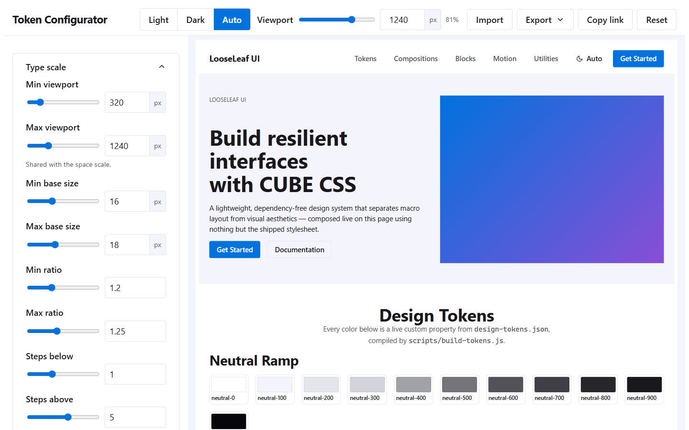
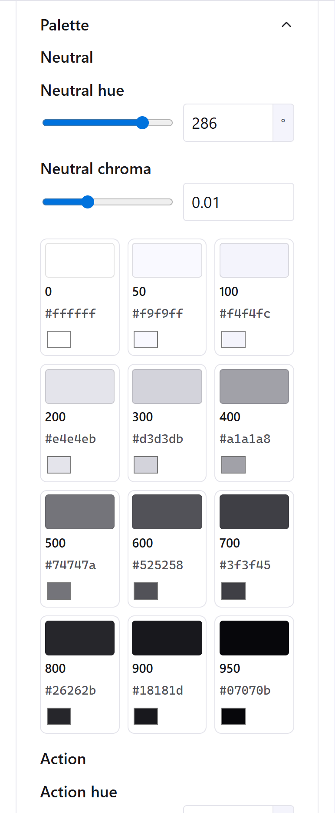
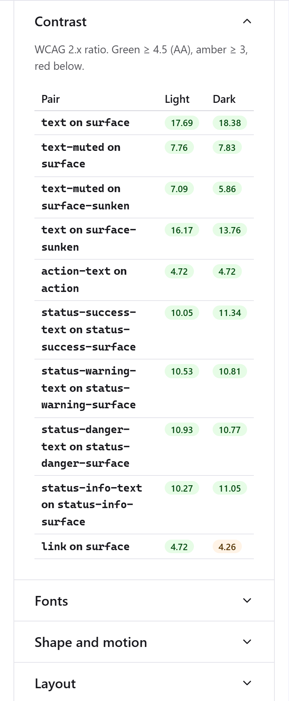
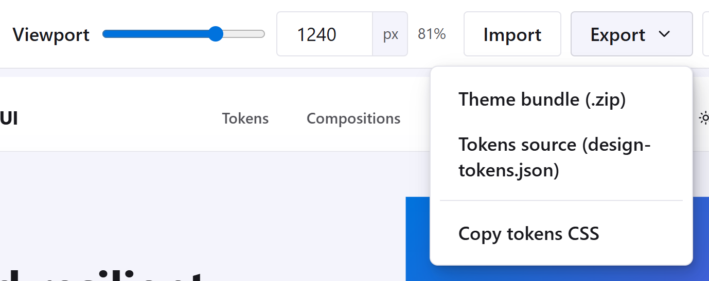

# LooseLeaf UI Component Library

[](https://github.com/StockoL/looseleaf-ui/blob/main/LICENSE)
[](https://github.com/StockoL/looseleaf-ui)

LooseLeaf UI is a lightweight, dependency-free, architecture-first CSS design system template built on the CUBE CSS Methodology (Composition, Utility, Block, Exception).

By decoupling intrinsic macro-layouts from visual block aesthetics and storing design parameters in a platform-agnostic JSON engine, LooseLeaf UI allows lean engineering teams to compose resilient, highly accessible, and performance-first user interfaces with zero framework overhead.

### Make your theme in the browser

**[Open the token configurator](https://stockol.github.io/looseleaf-ui/)** to set your type scale, spacing, colours, fonts and shapes while every block previews live, in light and dark, at any width. Export a theme bundle and drop it into your project; no build step needed. New to it? Read the [configurator walkthrough](docs/CONFIGURATOR.md).

[](https://stockol.github.io/looseleaf-ui/)

---

## Table of Contents

1. [Quick Start](#quick-start)
   - [Theming: from the configurator to your project](#theming)
   - [Configurator walkthrough](docs/CONFIGURATOR.md) (separate page, with screenshots)
2. [Planning & Pre-Production Workflow](#planning)
3. [The CUBE CSS Architectural Paradigm](#architecture)
4. [The Token Engine & Workflow](#token-engine)
5. [Directory & Layer Structure](#directory)
6. [Tier Breakdown & Implementation Guide](#tiers)
   - [Tier 1: Global Layer & Reset](#tier-1)
   - [Tier 2: Compositions](#compositions)
   - [Tier 3: Blocks](#blocks)
   - [Motion layer](#motion)
   - [Tier 4: Utilities](#utilities)
7. [Behaviours & Theme Scripts](#behaviors)
8. [Commands](#commands)
9. [Versioning & Releases](#versioning)
10. [Crediting LooseLeaf UI in your project](#credit)
11. [Authors & Acknowledgements](#authors)

---

## 1. <a name="quick-start"></a> Quick Start

### Plain HTML

Load the release files from jsDelivr, always pinned to a tag (never `@main`), and add your theme's tokens after the stylesheet:

```html
<meta name="viewport" content="width=device-width, initial-scale=1, viewport-fit=cover" />
<meta name="color-scheme" content="light dark" />

<!-- Blocking on purpose: applies the stored light/dark choice before first paint -->
<script src="https://cdn.jsdelivr.net/gh/StockoL/looseleaf-ui@v2.3.0/dist/theme.js"></script>
<link rel="stylesheet" href="https://cdn.jsdelivr.net/gh/StockoL/looseleaf-ui@v2.3.0/dist/looseleaf.css" />
<link rel="stylesheet" href="/css/looseleaf-tokens.css" /> <!-- your theme (optional) -->
<script src="https://cdn.jsdelivr.net/gh/StockoL/looseleaf-ui@v2.3.0/dist/looseleaf.js" defer></script>
```

The same files are attached to every [GitHub release](https://github.com/StockoL/looseleaf-ui/releases) if you'd rather host them yourself. Without a theme you get the default tokens; see [Theming](#theming) to make your own.

Then compose with the classes below. [examples/index.html](examples/index.html) is the living documentation: one section per composition and block, built with nothing but the shipped files.

Baseline browsers are Chrome 117+, Safari 17.4+ and Firefox 129+, so cascade layers, container queries, `:has()`, `color-mix()` and `@starting-style` are used freely. On Apple devices that means **iOS and iPadOS 17.4 or later**; iOS 16 and earlier are not supported (exclusive `<details name>` accordions need Safari 17.2, and dialog and drawer animations need 17.4).

### Django

Django projects use the `django-looseleaf` package in [packages/django-looseleaf/](packages/django-looseleaf/README.md). One `INSTALLED_APPS` entry ships the CSS and JS, template tags for the head and the theme, and a form renderer that outputs LooseLeaf markup from `{{ form }}`. A theme bundle drops into `static/` and is switched on with one setting, `LOOSELEAF_THEME`. See its README for setup.

### <a name="theming"></a> Theming: from the configurator to your project

Every project gets its own colours, type scale, spacing, fonts and shapes without cloning this repository. The configurator does the compiling in your browser, so for most projects there is no build step at all. Pick the route that matches your project.

#### Step 1 (everyone): make a theme

The [configurator walkthrough](docs/CONFIGURATOR.md) explains every control in detail. In short:

1. Open the hosted [token configurator](https://stockol.github.io/looseleaf-ui/). It previews every block live, in light and dark, at any viewport width, and the contrast table flags any text that drops below WCAG AA.
2. Adjust the type scale, spacing, palette hues, fonts, radii and defaults until the preview looks like your site. Each palette is just a hue and a chroma, and the contrast table shows straight away whether text stays readable:

    

3. Check the preview in both schemes and at a phone width with the toolbar's **Light / Dark / Auto** switch and **Viewport** field.
4. **Export → Theme bundle** downloads `looseleaf-theme.zip`:

   

   The bundle contains three files:

   | File | What it is | Who reads it |
   | --- | --- | --- |
   | `looseleaf-tokens.css` | Your tokens compiled, wrapped in `@layer global` | the browser |
   | `tokens.resolved.json` | Every token's final light and dark value | `django-looseleaf` (meta tags, `ll_token`) |
   | `design-tokens.json` | The source: your inputs and overrides | the configurator, when you re-import to keep editing |

   Keep all three in the project and commit them. `design-tokens.json` is the only one you ever edit, and only through the configurator (**Import**, change, **Export** again).

#### Route A: Django

```bash
pip install django-looseleaf
```

Unzip the bundle into any app's `static/theme/` (or a `STATICFILES_DIRS` entry), then:

```python
# settings.py
INSTALLED_APPS = [
    # ...
    "django.forms",
    "django_looseleaf",
]
FORM_RENDERER = "django_looseleaf.renderers.LooseLeafFormRenderer"
LOOSELEAF_THEME = "theme"   # the static prefix you unzipped into
```

```django
{# templates/base.html #}
<!doctype html>
<html lang="en">
  <head>
    <meta charset="utf-8">
         {# viewport with safe areas, color-scheme, theme-color from YOUR tokens #}
    <title>My site</title>
        {# applies the stored light/dark choice before first paint #}
          {# looseleaf.css, then theme/looseleaf-tokens.css #}
    
  </head>
  <body>
    
    
  </body>
</html>
```

`python manage.py check` confirms the theme is wired (`looseleaf.E002` if the CSS can't be found, `W003` if the JSON is missing). `{{ form }}` now renders LooseLeaf markup. Full tag and renderer reference: [packages/django-looseleaf/README.md](packages/django-looseleaf/README.md).

#### Route B: plain HTML or any other backend

Put `looseleaf-tokens.css` wherever you serve static files and load it **after** the base stylesheet:

```html
<meta name="viewport" content="width=device-width, initial-scale=1, viewport-fit=cover" />
<meta name="color-scheme" content="light dark" />
<script src="https://cdn.jsdelivr.net/gh/StockoL/looseleaf-ui@v2.3.0/dist/theme.js"></script>
<link rel="stylesheet" href="https://cdn.jsdelivr.net/gh/StockoL/looseleaf-ui@v2.3.0/dist/looseleaf.css" />
<link rel="stylesheet" href="/css/looseleaf-tokens.css" />
<script src="https://cdn.jsdelivr.net/gh/StockoL/looseleaf-ui@v2.3.0/dist/looseleaf.js" defer></script>
```

Order is the whole mechanism: both stylesheets declare the `global` layer, and later wins inside a layer. `tokens.resolved.json` is optional here; use it if your templating needs a literal colour (an email, an SVG fill, a `theme-color` meta).

#### Route C: you only have `design-tokens.json`

If you exported **Tokens source** rather than the bundle, or want the compile step in your own pipeline (CI, a monorepo, a watch task), compile it with the same code the configurator and this repo use:

```bash
npx looseleaf-ui compile design-tokens.json --out static/theme/
```

That writes `looseleaf-tokens.css` and `tokens.resolved.json` into the folder, and you continue with Route A or B. Node 20+ is the only requirement. For the same `design-tokens.json`, the CSS is byte-identical to the configurator's export; the JSON differs only in its `$generated` timestamp.

The `looseleaf-ui` npm package is published from 2.1.0 on. The same command also runs straight from GitHub, with nothing published:

```bash
npx github:StockoL/looseleaf-ui compile design-tokens.json --out static/theme/
```

#### Updating a theme later

Open the [configurator](https://stockol.github.io/looseleaf-ui/), **Import** your `design-tokens.json`, change what you need, **Export** the bundle again and replace the three files. Upgrading LooseLeaf (`pip install -U django-looseleaf`, or bumping the jsDelivr tag) never touches your theme; within a major version any token your theme doesn't know falls back to the default, and across majors `django-looseleaf` warns (`W004`) so you know to re-export.

#### Changing this repository's defaults (maintainers)

The repo's own `design-tokens.json` is a theme like any other. Export **Tokens source** from the configurator, save it over the file at the repo root, then:

```bash
npm run build          # recompiles variables.css, dist/, the Django package's static copies and docs/TOKENS.md
npm run bump -- 2.0.1  # when it's ready to ship; then commit and push the tag
```

`npm run check` and the Django package's `test_build_sync` fail if the committed build output is out of date, so a forgotten build can't ship.

---

## 2. <a name="planning"></a> Planning & Pre-Production Workflow

A primary tenet of the LooseLeaf philosophy—derived from Andy Bell’s Complete CSS milestones—is that writing CSS code is the final step, not the first. Jumping directly into an IDE to write styles without pre-production planning leads to specificity battles, arbitrary media queries, and high technical debt.

LooseLeaf UI mandates a strict four-phase pre-production engineering lifecycle:

1. Sketch-Up (Planning) -> 2. Core Build (HTML-First) -> 3. Architectural (CUBE Layering) -> 4. Flair & Polish (Animations)

### Phase 1: Sketch-Up (Away from the IDE)

Before opening an editor, analyse the UI mockup or wireframe and complete the following non-coding steps:

1. Identify Macro-Compositions: Draw boxes around content groupings to identify structural primitives (`.sidebar`, `.grid`, `.switcher`, `.cluster`, `.flow`).
2. Define Data Tracks & Limits: Establish max-inline-size boundaries (`--measure`) and identify intrinsic container wrapping points.
3. Isolate Visual Blocks: Mark repeating, self-contained visual components (`.card`, `.button`, `.badge`, `.accordion`).
4. Log the "Icebox": If a requested feature or complex aesthetic lacks clarity or breaks layout predictability, log it into an Icebox Backlog to protect production velocity.

### Phase 2: Core Build (Accessibility & HTML Structure)

Build the layout using raw, semantic HTML tags (`<main>, <nav>, <article>, <dialog>, <button>`). Ensure all ARIA attributes (`aria-expanded`, `aria-controls`, `aria-invalid`) and keyboard navigation routes function perfectly before applying visual styling.

### Phase 3: Architectural Layering (CUBE CSS)

Apply layout compositions and visual blocks using standard class names and CSS Custom Properties. Keep specificity flat by leveraging CSS Cascade Layers (`@layer`).

### Phase 4: Flair Pass

Inject micro-interactions, hardware-accelerated transitions (`.anim-lift`), ambient backgrounds (`.bg-mesh`), and fine-tuned hover physics on top of the established layout.

---

## 3. <a name="architecture"></a> The CUBE CSS Architectural Paradigm

Traditional frameworks couple layout positioning directly with component styling, forcing developers to write non-DRY utility strings or override margins constantly. LooseLeaf UI enforces strict CUBE CSS boundaries:

C - COMPOSITION (Macro Layout & Spatial Flow)
U - UTILITY (Single-Purpose Overrides)
B - BLOCK (Pure Self-Contained Aesthetics)
E - EXCEPTION (State Toggles via data-\* attributes)

- Composition (C): Manages structural positioning and intrinsic space (e.g., `.flow`, `.sidebar`, `.grid`). Compositions never contain background colours, borders, or typography styles.
- Utility (U): Single-purpose classes that apply specific properties cleanly (e.g., `.visually-hidden`, `.text-center`).
- Block (B): Pure, portable visual components (e.g., `.button`, `.card`, `.input`). Blocks care only about their internal aesthetics (padding, border, background). They have zero external margins or fixed width/height constraints.
- Exception (E): State-based overrides driven by HTML attributes ([data-state="open"], [data-status="danger"]) that update local block parameters dynamically.

Layout responds to the space a component actually has, not the viewport: compositions are intrinsic, and the few size switches (navbar collapse, bento spans, sticky sidebar) are `@container` queries at the one documented breakpoint, `45rem`.

---

## 4. <a name="token-engine"></a> The Token Engine & Workflow

To maintain a true Single Source of Truth across the entire tech stack (including front-end stylesheets and back-end templates such as Python/Django), design decisions are extracted out of the CSS and stored in a platform-agnostic JSON document.

### Three tiers

1. **Raw** tokens are the palette and scales (`--neutral-*`, `--action-*`, `--step-*`, `--space-*`). They are derived from inputs and never used for colour or type by blocks.
2. **Semantic** tokens are named by purpose (`--color-surface-raised`, `--color-action`, `--gutter`, `--inset-control`, `--text-body`, `--radius-control`, `--duration-quick`, `--layer-nav`). Blocks and compositions use these, and dark mode re-points them.
3. **Component** variables live inside each block with a semantic default (`--button-bg`, `--card-padding`, `--dropdown-width`), and exceptions reassign them.

### 1. Source Tokens (design-tokens.json)

`design-tokens.json` stores the *inputs* to the design, not hand-copied outputs:

- `$utopia` holds the [Utopia](https://utopia.fyi/) settings (viewports, base sizes, ratios, space multipliers). The fluid `--step-*` type scale and `--space-*` scale are derived from them at build time.
- `$palette` holds OKLCH hues and chromas. The `--neutral-*` ramp, the `--action-*` and `--accent-*` steps and every status colour (light and dark) are derived from it.
- `$shape.shadow` holds the shadow strength, softness and light direction. `--shadow-color` (the neutral hue, darkened, as OKLCH components) and the layered `--shadow-raised`, `--shadow-floating` and `--shadow-overlay` are derived from it, one light source for all three.
- `$motion` holds a spring (mass, stiffness, damping), three durations, the press scale, the lift distance and three switches. `--ease-spring` is simulated from the spring as a CSS `linear()` curve, and the `--duration-*`, `--press-scale`, `--lift-distance`, `--reveal-animation` and `--navbar-stuck-padding` tokens are derived from the rest.
- Everything else is a semantic token named by purpose. Colour roles carry a light and a dark value, and `{group.key}` references another token.

```json
{
  "$palette": { "action": { "hue": 255, "chroma": 0.2 } },
  "color": {
    "surface": { "light": "{neutral.0}", "dark": "{neutral.950}" },
    "action": "{action.500}"
  },
  "gutter": { "$value": "{space.s}", "$purpose": "Default gap inside compositions." }
}
```

To change a derived value, change its input. An explicit value inside a derived group (for example `"neutral": { "500": "#71717a" }`) wins and is flagged as overridden.

### 2. The Configurator (tools/configure.html)

Use it [hosted on GitHub Pages](https://stockol.github.io/looseleaf-ui/), or open `tools/configure.html` by double-clicking it (no server needed). It previews the real demo page in a resizable frame while you adjust the Utopia scales, palette hues, fonts, radii, motion (with a spring designer) and default styles, and shows a live WCAG contrast table for both schemes. **Export** offers a theme bundle for projects (see [Theming](#theming)), the `design-tokens.json` source, or the compiled tokens CSS on the clipboard. To change this repository's defaults, save the source over `design-tokens.json` and run `npm run build`. The preview uses the same compiler as the build, so what you see is exactly what you get. The [walkthrough](docs/CONFIGURATOR.md) covers each control with screenshots.

### 3. The Compiler (scripts/build-tokens.js)

A zero-dependency Node.js wrapper around `scripts/tokens-core.mjs`, a pure compiler shared with the configurator. It writes:

- `src/01-global/variables.css`: light values on `:root`, dark values for `prefers-color-scheme: dark`, and a `[data-theme="dark"]` override
- `dist/tokens.resolved.json`: every token fully resolved, for back-end use
- [docs/TOKENS.md](docs/TOKENS.md): the generated reference of every token, its tier and its light and dark value, plus a WCAG contrast table

---

## 5. <a name="directory"></a> Directory & Layer Structure

```text
looseleaf-ui/
├── design-tokens.json         <-- Single source of truth (token inputs)
├── package.json               <-- Manifest and build commands
├── scripts/
│   ├── tokens-core.mjs        <-- Pure token compiler (shared with the configurator)
│   ├── utopia.mjs             <-- Pure fluid type and space maths
│   ├── spring.mjs             <-- Pure spring simulation, emitted as a linear() easing
│   ├── color.mjs              <-- Pure OKLCH and WCAG contrast maths
│   ├── zip.mjs                <-- Pure store-only ZIP writer (theme bundles)
│   ├── build-tokens.js        <-- Writes variables.css, tokens.resolved.json, TOKENS.md
│   ├── build-tools.js         <-- Bundles the pure modules for the configurator
│   ├── build-css.js           <-- Bundles src/index.css, copies the scripts to dist/
│   ├── build-django.js        <-- Syncs dist/ into the Django package
│   ├── check.js               <-- Guardrail linter (npm run check)
│   └── bump-version.js        <-- Lockstep version for npm and Python (npm run bump)
├── src/
│   ├── index.css              <-- Orchestrator and @layer order
│   ├── 01-global/             <-- reset, variables (generated), global-styles
│   ├── 02-compositions/       <-- wrapper, region, center, flow, cluster, sidebar,
│   │                              grid, reel, switcher, frame, bento
│   ├── 03-blocks/             <-- skip-link, button, field, input, select, textarea,
│   │                              choice, input-group, badge, accordion, dropdown, card,
│   │                              navbar, modal, offcanvas, alert, table, prose,
│   │                              pagination, breadcrumb, marquee, bg-mesh, swatch
│   ├── 04-utilities/          <-- accessibility, icon, indent, text, colors
│   ├── 05-motion/             <-- entrances, press, height, page, reveal, stuck, lift,
│   │                              glass, micro
│   └── scripts/               <-- theme.js, behaviours/ (one module each, joined into looseleaf.js)
├── dist/                      <-- looseleaf.css, looseleaf.js, behaviours/, theme.js, tokens.resolved.json
├── examples/index.html        <-- Living demo (also the configurator's preview)
├── tools/                     <-- configure.html, configure.js, configure.css, tokens-lib.js
├── index.html                 <-- GitHub Pages entry: redirects to the configurator
├── .github/workflows/         <-- ci.yml, release.yml, pages.yml
├── docs/
│   ├── COMPOSITIONS.md        <-- Composition case studies and block guidelines
│   ├── CONFIGURATOR.md        <-- Configurator walkthrough
│   ├── images/                <-- Configurator screenshots
│   ├── SUPPORT.md             <-- Browser tiers and what each enhancement needs
│   └── TOKENS.md              <-- Generated token reference
└── packages/django-looseleaf/ <-- Django package
```

The cascade layers run lowest to highest: `reset`, `global`, `compositions`, `blocks`, `motion`, `utilities`.

---

## 6. <a name="tiers"></a> Tier Breakdown & Implementation Guide

### <a name="tier-1"></a> Tier 1: Global Layer & Reset (src/01-global/)

- Andy Bell's "A (more) Modern CSS Reset", plus a global reduced-motion switch.
- Body type, colour and surface from semantic tokens; headings mapped to `--heading-1` … `--heading-4` with balanced wrapping.
- One focus style for everything: a 2px `--color-focus` ring on `:focus-visible`. No block removes it.
- Unstyled links use `--color-link` and the configurable underline (`--link-decoration`).
- The reading measure (`--measure`) caps running text inside `.flow` and `.prose` only.
- Touch and mobile safeguards: `--target-min` (44px) for interactive controls, `dvh` instead of `vh`, and safe-area insets (`--safe-top` and friends).

### <a name="compositions"></a> Tier 2: Compositions (src/02-compositions/)

Compositions govern spacing and alignment without injecting aesthetic styling. Tune them inline with custom properties, e.g. `style="--switcher-threshold: 40rem"`. [docs/COMPOSITIONS.md](docs/COMPOSITIONS.md) walks through real layouts built from them.

| Class | Purpose | Custom properties and exceptions |
| --- | --- | --- |
| `.wrapper` | Page-section shell: caps a site-wide width and centres it | `--wrapper-max-width`, `--wrapper-gutters` |
| `.region` | Vertical breathing room for a page section | `--region-padding`, `[data-size="small"]`, `[data-size="large"]` |
| `.center` | Caps content to the reading measure and centres it | `--center-max-width`, `--center-gutters`, `[data-and-text]`, `[data-intrinsic]` |
| `.flow` | Vertical rhythm between siblings | `--flow-space` |
| `.cluster` | Wrapping horizontal group | `--cluster-space`, `--cluster-justify`, `--cluster-align` |
| `.sidebar` | Target-width panel beside fluid content, stacking when space runs out | `--sidebar-target-width`, `--sidebar-content-min-width`, `--sidebar-space`, `--sidebar-align`, `[data-side="right"]`, `[data-sticky]` (with `--sticky-offset`) |
| `.switcher` | Row that becomes a stack below a threshold | `--switcher-threshold` |
| `.grid` | Auto-filling intrinsic grid | `--grid-min-item-size`, `--grid-placement`; `[data-subgrid]` lines up the parts of every item in a row (each spans `--subgrid-rows` rows, default 3) |
| `.reel` | Horizontal scroll-snap strip; give a scrolling reel `tabindex="0"`, `role="region"` and an `aria-label` so keyboard users can scroll it | gap from `--gutter` |
| `.frame` | Crops media to an aspect ratio | `--frame-ratio` |
| `.bento` | Dense intrinsic grid with spanning items | `--bento-min`, `--bento-row-min`, `--bento-space`; items take `[data-span]` and `[data-row-span]` |

**Wrapper vs. Center.** Both cap a width and centre it, but they are not interchangeable. `.wrapper` is the macro, page-section shell — apply it once per full-bleed section to align content to a wide, site-level edge margin (`--wrapper-max`, default `80rem`), padding included in the cap. `.center` is a content primitive — apply it to prose or hero copy that must cap at the narrower typographic reading measure (`--measure`, default `60ch`), using `box-sizing: content-box` so its gutter padding never eats into that measure. See [docs/COMPOSITIONS.md](docs/COMPOSITIONS.md#golden-rules) for the nesting pattern.

### <a name="blocks"></a> Tier 3: Blocks (src/03-blocks/)

Blocks care only about internal styling and are purged of external margins. Variants and states are exceptions on data or ARIA attributes, which only reassign the block's own variables.

| Class | Purpose | Exceptions | JS hook |
| --- | --- | --- | --- |
| `.skip-link` | First focusable link, revealed on focus | — | — |
| `.button` | Actions | `data-variant`: primary, secondary, ghost, danger; `data-size`: small, large; `[data-icon-only]`; `:disabled` and `[aria-disabled="true"]`; `data-state`: loading (pair with `aria-busy="true"`), done (a checkmark draws in place of the label) | `[data-copy]` sets the copied state |
| `.field` | Label, control, `.field__hint` and `.field__error`; `.field__controls` sets a control beside its companion; `.fieldset` and `.legend` group choices | `[data-status="danger"]` | — |
| `.input` | Text-like inputs and range sliders (shares a base with select and textarea) | `[aria-invalid="true"]`, `:disabled` | — |
| `.select` | Native select with a theme-aware chevron | `[aria-invalid="true"]`, `[multiple]` | — |
| `.textarea` | Multi-line input, vertical resize only | `[aria-invalid="true"]` | — |
| `.choice` | Checkbox or radio with its label (`.choice__input`); `.choice-group` stacks them | `.choice-group[data-variant="segmented"]`; `.choice[data-variant="switch"]` with a `.choice__thumb` (the native `switch` where Safari has it) | — |
| `.input-group` | Input joined to `.input-group__addon` or a button | — | — |
| `.badge` | Status labels | `data-status`: info, success, warning, danger; `[data-placement="floating"]` | —; `[data-pulse]` (a ring that pulses), `[data-bump]` (pops on the spring when rendered), `[data-interactive]` (press feedback) |
| `.accordion` | Disclosure list on native `<details>` (`.accordion__item`, `.accordion__trigger`, `.accordion__content`, `.accordion__icon`) | `[open]`; a shared `name` makes an exclusive group | none needed |
| `.dropdown` | Menu inside a native `<details class="dropdown-wrapper">` whose `<summary>` is the trigger (`.dropdown__item`, `.dropdown__divider`); opens without JavaScript | `[open]` on the wrapper; `[data-align="end"]` | optional: Escape, outside click, arrow keys |
| `.card` | Surface; `.card__body` carries the padding, direct media sits flush | `--card-padding`, `--card-media-ratio`; a floating badge is never clipped; `[data-interactive]` lifts on hover | — |
| `.navbar` | Site header (`.navbar__brand`, `.navbar__menu`, `.navbar__link`); collapses below 45rem of its own width, where an empty `<details class="navbar__toggle">` before the menu opens it without JavaScript | `[data-sticky]`; `[data-glass]` (translucent, blurs what scrolls under it); `[data-underline="slide"]` on links; `[open]` on the toggle; `--navbar-padding` (on its children) | optional: Escape |
| `.modal` | Native `<dialog>`, animated in and out | `[open]` | `commandfor` with `command="show-modal"` or `"close"` (native; script fallback) |
| `.offcanvas` | Drawer on native `<dialog>` | `[data-position="left"]` | `commandfor` with `command="show-modal"` or `"close"` (native; script fallback) |
| `.alert` | Inline messages with an optional `.alert__close` | `data-status`: info, success, warning, danger; `[data-state="removing"]` | `.alert__close` |
| `.toast` | Short-lived messages (`.toast__message`) inside a `.toast-region`; in the page flow without JavaScript, floating and self-dismissing with it | `data-status`: info, success, warning, danger; `data-duration`; the region gets `[data-js]` | `toast.js` adds `.toast__close` |
| `.skeleton` | Placeholder shapes while content loads; the container is `aria-busy="true"`, the shapes `aria-hidden="true"` | `data-shape`: text, title, avatar, block; the shimmer stops under reduced motion | — |
| `.progress` | Native `<progress>` and `<meter>`, styled; give each a label | indeterminate when `<progress>` has no `value`; `<meter>` colours follow `low`, `high` and `optimum` | — |
| `.tabs` | `.tabs__list` of `.tabs__tab` links to sibling `.tabs__panel` sections; a jump list without JavaScript | `[aria-selected="true"]` on the tab, `[data-state="active"]` on the panel; the block gets `[data-js]` | `tabs.js` |
| `.table` | Data tables inside a scrolling `.table-wrapper` | `[data-striped]`, `[data-hover]`, `[data-density="compact"]`; cells take `[data-align="end"]` | — |
| `.prose` | Rich text you don't control (CMS, Markdown) | — | — |
| `.pagination` | Page links (`.pagination__list`, `.pagination__link`, `.pagination__gap`) | `[aria-current="page"]`, `[aria-disabled="true"]` | — |
| `.breadcrumb` | Location trail (`.breadcrumb__list`, `.breadcrumb__item`) | `[aria-current="page"]` | — |
| `.marquee` | Looping strip of `.marquee__track` rows | `--marquee-duration`, `--marquee-gap` | — |
| `.bg-mesh` | Ambient drifting wash of the action and accent hues | `--mesh-duration`, `--mesh-strength` | — |
| `.swatch` | Colour tile with `.swatch__tile`, `.swatch__label`, `.swatch__hex` | `--swatch-color`, `[data-state="overridden"]` | — |

### <a name="motion"></a> Motion layer (src/05-motion/)

Motion is an enhancement: the system is complete without this folder. Its `motion` layer sits between `blocks` and `utilities`, so it can refine any block and utilities still override it. Each file is fenced by `@supports` or the reduced-motion switches, and [docs/SUPPORT.md](docs/SUPPORT.md) lists which browsers get each one and what the rest see instead.

**Two master switches.** Every duration in LooseLeaf is multiplied by `--motion-scale` (`calc(var(--duration-base) * var(--motion-scale))`, and the same for every `--duration-*` token), and `npm run check` rejects any that isn't. The operating system's reduced-motion setting sets `--motion-scale` to 0, and so does `data-motion="reduced"` on `<html>`, for a choice offered on the site. Either one makes all motion instant at once. `--motion-scale` is deliberately not a token, so a theme can never undo it.

| File | What it does | Tokens |
| --- | --- | --- |
| `entrances.css` | Alerts, toasts and menus come in on partial keyframes (menus grow from their trigger); dialogs and drawers animate in and out with `@starting-style` | `--duration-enter`, `--duration-exit`, `--ease-out-expo` |
| `press.css` | Buttons, choices and `.badge[data-interactive]` shrink slightly while pressed | `--press-scale` |
| `height.css` | Accordion items open and close smoothly | `--duration-base` |
| `page.css` | Same-site page loads cross-fade (a sticky, non-glass navbar holds still); a theme change grows as a circle from the toggle | `--duration-page`, `--duration-slow` |
| `reveal.css` | `[data-reveal]` elements fade in as they scroll into view (opt-in; never hidden without support) | `--reveal-distance` |
| `stuck.css` | A sticky navbar tightens once it is stuck to the top | `--navbar-padding` |
| `lift.css` | `.anim-lift` and `.card[data-interactive]` rise on hover, with standard easing (a hover the pointer cuts short shouldn't spring); a `::after` with `--shadow-floating` fades in, so the layered shadow is never animated | `--lift-distance`, `--shadow-floating` |
| `glass.css` | `.navbar[data-glass]`: translucent and blurred, with the blur reaching below the edge so there's no hard line | — |
| `micro.css` | Pulse and bump badges, the sliding underline, staggered reveals (`[data-reveal-stagger]`), the focus ring easing in, `[data-dropped]` settling after a drag, and the theme toggle's sun and moon trading places | `--scheme-dark`, `--ease-spring` |

The demo's Motion section shows each one and reports whether the current browser runs it.

### <a name="utilities"></a> Tier 4: Utilities (src/04-utilities/)

Utilities sit at the top of the layer stack and do one thing each.

- `.visually-hidden`: hidden visually but still announced; reveals itself when focused. A `[hidden]` rule restores `display: none` on blocks that set their own display.
- `.icon`: sizes an inline SVG to the text and strokes it in `currentColor`; `[data-size="s"]` and `[data-size="l"]`. No icon library ships: paste paths or keep a `<symbol>` sheet.
- `.text-center`, `.text-uppercase`, `.truncate`, `.text-small`, `.text-lead`
- `.clamp`: cuts text after `--clamp-lines` lines (default 3) with an ellipsis
- `.text-primary`, `.text-muted`, `.text-danger`, `.bg-surface-base`, `.bg-surface-sunken`, `.bg-primary`, `.bg-gradient`
- `.indent`: decorative edge accent (`--indent-size`, `--indent-color`)

---

## 7. <a name="behaviors"></a> Behaviours & Theme Scripts

### dist/looseleaf.js (src/scripts/behaviours/)

An enhancement, not a dependency: every menu, link and form already works without it, and `npm run test:nojs` checks that in CI. Native elements come first (`<details>`, `<dialog>`, Invoker Commands, form validation, `scroll-snap`); a module exists only where nothing native does the job, and its header says why. Each one uses event delegation on the document, exports nothing, works as a classic or module script, and is safe to include twice.

`looseleaf.js` joins all of them and is the recommended single include: 36.4 KB as shipped, 10.1 KB gzipped, about a quarter of it comments. To take only some, import them one by one from `dist/behaviours/`:

```html
<script type="module" src="https://cdn.jsdelivr.net/gh/StockoL/looseleaf-ui@v2.3.0/dist/behaviours/tabs.js"></script>
```

| Module | Why it needs JavaScript | Without it | Hooks |
| --- | --- | --- | --- |
| `dialog.js` | Invoker Commands fallback for older browsers; nothing native closes a dialog on a backdrop click | Dialogs open in browsers with Invoker Commands (Chrome 135, Safari 26.2, Firefox 144); content dialogs need a second route (below) | `button[commandfor][command="show-modal"]`, `command="close"` |
| `menus.js` | `<details>` has no Escape, outside-click or focus-out close, arrow keys or one-open-at-a-time | Menus open and close from their summary; Tab reaches every item | `details.dropdown-wrapper`, `details.navbar__toggle` |
| `focus-target.js` | Following an in-page link scrolls but leaves focus behind | The browser scrolls (smoothly, from CSS); focus stays put | `a[href^="#"]` |
| `dismiss.js` | Removing an element needs script | The alert stays readable | `.alert__close` |
| `copy.js` | Clipboard API | The text is on the page to copy by hand | `[data-copy]`, `data-copy-message` |
| `tabs.js` | Tab list semantics: roles, `aria-selected`, roving tabindex, arrow, Home and End keys | A jump list of in-page links, with every panel showing | `.tabs` (see the block table) |
| `toast.js` | Queue, auto-dismiss that pauses on hover and focus, staying above an open dialog, creating toasts from script | Server-rendered toasts stay where their region is, readable like alerts | `.toast-region`, `[data-toast]`, the `looseleaf:toast` event |
| `form-feedback.js` | Native validation messages are bubbles that vanish, appear only on submit and leave the field unmarked | The browser's own validation on submit; server errors as usual | controls in a `.field` in a `<form>` without `novalidate`; `[data-maxlength-counter]` |
| `password-reveal.js` | Showing a password means switching the input's type | An ordinary password field (the script adds the button, so none does nothing) | `input[type=password][data-reveal-password]` in an `.input-group` |
| `done-state.js` | CSS can't know an action succeeded | Nothing changes visually; the action still happened | `[data-done-on="submit"]`, `[data-done-on="request"]` (htmx), the `looseleaf:done` event |
| `sound.js` | CSS can't play sound | Silence | `[data-sound="click"]`, `"toggle"`, `"success"`; opt-in twice (below) |
| `legacy.js` | Keeps the 2.0 markup working through 2.x (below) | 2.0 markup does nothing | removed in 3.0 |

Some details:

- **Menus.** Escape closes a menu and returns focus to its trigger. ArrowDown or ArrowUp on the trigger opens it at the first or last item; arrows, Home and End move through the items. The collapsed navbar menu closes on Escape and when one of its in-page links is followed. The navbar's links themselves are a plain list that Tab moves through; arrow-key roving is for menus.
- **Toasts.** Toasts dismiss themselves after five seconds (`data-duration` in milliseconds; `0` keeps a toast), pausing while the pointer or focus is on any of them. Danger toasts stay until dismissed and are announced with `role="alert"`. At most three show at once; the rest queue. Create one from a button with `data-toast="Saved."` and `data-toast-status="success"`, or from your own script with `document.dispatchEvent(new CustomEvent("looseleaf:toast", { detail: { message: "Saved.", status: "success" } }))`.
- **Done state.** After a successful action, the button's label steps aside for a checkmark that draws itself, and it clears after two seconds. Copy buttons use it automatically. Mark a form's submit button `data-done-on="submit"`, an htmx element `data-done-on="request"`, or dispatch `looseleaf:done` on any control from your own code.
- **Sound.** Off twice over. The site opts in with `data-sound` on `<html>` (in Django, `` with `LOOSELEAF_SOUNDS`); each visitor then turns it on with a `[data-sound-toggle]` button, which defaults to off. With no toggle on the page nothing plays, because there is no reduced-sound media query and the toggle is the only consent. Sounds play on activation only, never on hover or focus. They are synthesised by default; `data-sound-src="/path/"` plays your own `click.mp3`, `toggle.mp3` and `success.mp3`. Volume is the `--sound-volume` token (0.3).
- **Form feedback.** It leaves the browser's validation rules alone and changes only how the messages appear. Without it, `:user-invalid` still marks a field invalid once it has been left; with it: written into the field's `.field__error` (created if missing, and linked with `aria-describedby`) as soon as the visitor leaves a field they changed, corrected as they type, and on submit with focus moved to the first problem. A form with `novalidate` is left untouched, because it validates on the server.

Not included, on purpose: a combobox, a date picker, a carousel, drag and drop, and haptics. The first four are bespoke and they are where component libraries bloat. Use `<input list>` with `<datalist>`, `<input type="date">` and the `.reel` composition with scroll snap, and pair any drag library with the `[data-dropped]` settle in `micro.css`. Haptics: `navigator.vibrate` is Android-only and Safari has no web haptics API; the switch variant uses Safari's native `<input type="checkbox" switch>`, the one route to iOS haptics.

`theme.js` also sets `data-js` on `<html>`. CSS may hide something because a script will reveal it only under `[data-js]`.

**Loading states are busy.** Every loading state (`.button[data-state="loading"]`, `.skeleton`, an indeterminate `.progress`) goes with `aria-busy="true"` on what is loading, so assistive tech hears that it is busy rather than reading placeholders.

**Dialogs need a second route.** Without JavaScript and without Invoker Commands, a dialog can't open. A dialog holding only a confirmation can live with that; one holding content can't. Put that content somewhere reachable without the dialog too: drawer navigation repeats the navbar's links, and a form in a modal is also a page of its own.

#### Upgrading markup from 2.0

The 2.0 markup still works through 2.x, with one console warning per kind; it stops working in 3.0.

```html
<!-- 2.0: opens only with JavaScript -->
<div class="dropdown-wrapper">
  <button class="button" type="button" data-toggle="dropdown" aria-haspopup="true" aria-expanded="false">Options</button>
  <div class="dropdown" role="menu">
    <a href="/edit" class="dropdown__item" role="menuitem">Edit</a>
  </div>
</div>

<!-- 2.1: a native disclosure -->
<details class="dropdown-wrapper">
  <summary class="button">Options</summary>
  <div class="dropdown">
    <a href="/edit" class="dropdown__item">Edit</a>
  </div>
</details>
```

```html
<!-- 2.0 navbar toggle -->
<button class="navbar__toggle" type="button" aria-expanded="false" aria-label="Menu">…</button>
<nav class="navbar__menu">…</nav>

<!-- 2.1: an empty <details> before the menu -->
<details class="navbar__toggle">
  <summary aria-label="Menu" aria-controls="primary-nav">…</summary>
</details>
<nav id="primary-nav" class="navbar__menu">…</nav>
```

```html
<!-- 2.0 dialog triggers -->
<button data-open-dialog="settings">Settings</button>
<button data-close-dialog>Close</button>

<!-- 2.1: Invoker Commands -->
<button type="button" commandfor="settings" command="show-modal">Settings</button>
<button type="button" commandfor="settings" command="close">Close</button>
```

### dist/theme.js (src/scripts/theme.js)

Load it as a blocking script in `<head>` (or inline it) so the saved choices are applied before first paint. It also sets `data-js` on `<html>` first of all.

- Any `[data-theme-toggle]` button cycles auto → light → dark, stores the choice and updates its `[data-theme-label]` text and ARIA state. "Auto" follows the operating system. Where view transitions exist and motion isn't reduced, the new theme grows as a circle from the toggle. Put both icons in a `[data-theme-icons]` span (`data-theme-icon="light"` and `"dark"`) and they trade places with a turn.
- Any `[data-sound-toggle]` button turns interface sounds on or off for this visitor (off by default), setting `data-sound-on` on `<html>`; `[data-sound-label]` reads "On" or "Off".
- Any `[data-motion-toggle]` button switches between following the operating system and reducing motion on this site, which sets `data-motion="reduced"` on `<html>` (every duration becomes 0). `aria-pressed` is true while motion is reduced, and `[data-motion-label]` reads "On" or "Reduced".

```html
<button class="button" type="button" data-variant="ghost" data-theme-toggle>
  <span data-theme-icons aria-hidden="true">
    <svg class="icon" data-theme-icon="light"><use href="#icon-sun" /></svg>
    <svg class="icon" data-theme-icon="dark"><use href="#icon-moon" /></svg>
  </span>
  Theme: <span data-theme-label>Auto</span>
</button>
<button class="button" type="button" data-variant="ghost" data-motion-toggle>
  Motion: <span data-motion-label>On</span>
</button>
```

---

## 8. <a name="commands"></a> Commands

| Command | What it does |
| --- | --- |
| `npm run build` | Tokens, configurator library, CSS and scripts, Django sync, then `check` |
| `npm run build:tokens` | Compile `design-tokens.json` |
| `npm run build:css` | Bundle `src/index.css` and copy the scripts into `dist/` |
| `npm run check` | Guardrail linter: no raw colours, radii, shadows, z-indices or durations outside tokens; no `outline: none` or `!important`; no viewport media queries; hover only on hover devices; every documented token and class must exist |
| `npm test` | Unit tests for the token maths, compiler and ZIP writer |
| `npm run test:nojs` | The demo with JavaScript disabled at 360 and 1280 px: every nav link and dropdown item reachable, the accordion opens, the form submits, nothing interactive hidden, every dialog link also reachable outside a dialog |
| `npm run test:browser` | Browser tests with Playwright: the keyboard and screen reader contracts of tabs, toasts, form feedback, password reveal and the motion toggle; both reduced-motion switches leave no duration on the demo, axe-core accessibility checks (WCAG 2.2 AA) on the demo and the configurator, and visual regression of the demo at 360, 768 and 1280 px in both schemes. Needs `npx playwright install chromium` once. |
| `npm run bump -- <version>` | Set the version everywhere it lives, then rebuild (see [Versioning](#versioning)) |

---

### Visual regression baselines

Screenshots are compared pixel for pixel against committed baselines in `tests/browser/__screenshots__/`. Fonts render differently on each operating system, so only Linux baselines are committed, and CI renders and compares them. After an intended visual change, run the **Update visual baselines** workflow from the Actions tab, download its `visual-baselines` artifact into `tests/browser/__screenshots__/`, and commit it. Locally, the first run writes baselines for your own system (git-ignored) and later runs compare against them, which is handy before and after a refactor.

---

## 9. <a name="versioning"></a> Versioning & Releases

The npm package and `django-looseleaf` share one version and follow [semantic versioning](https://semver.org/):

- **Major**: a token is renamed or removed, or a block's class or attribute contract changes.
- **Minor**: new tokens, blocks, compositions or exceptions.
- **Patch**: visual refinements within the existing tokens, and fixes.

Theme bundles record the version they were exported from (`$version` in both JSON files). What that means across releases:

- **Same major (2.0 → 2.4):** the theme keeps working. Tokens added after it was exported fall back to their defaults until you re-export.
- **New major (2.x → 3.0):** token names may have changed, and a renamed token in an old `looseleaf-tokens.css` simply stops applying, so the new default shows through in that spot. `django-looseleaf` warns about this (`looseleaf.W004`); plain-HTML sites get no warning, so keep the CDN version and the theme's major in step. To move a theme forward, import its `design-tokens.json` into the configurator for the new version and export the bundle again.

To release: `npm run bump -- 2.1.0` writes the version to `package.json`, `pyproject.toml` and `django_looseleaf.__version__` and rebuilds; move the Unreleased notes in [CHANGELOG.md](CHANGELOG.md) under `## [2.1.0] - <date>`; commit, then push the tag `v2.1.0`. The release workflow refuses a tag that doesn't match all three versions or has no changelog entry, reruns CI, creates the GitHub release with the changelog section as its notes and the built files attached, and publishes `django-looseleaf` to PyPI with trusted publishing.

---

## 10. <a name="credit"></a> Crediting LooseLeaf UI in your project

The MIT licence asks only that the licence notice at the top of `looseleaf.css` (and of the scripts) stays in place. Credit anywhere else is a courtesy, and appreciated. To say what your site is built on, copy and adapt this:

```markdown
This site is built on [LooseLeaf UI](https://github.com/StockoL/looseleaf-ui), a CSS foundation rather than a kit of ready-made components. It follows the CUBE CSS method, keeping layout, utilities and components apart, and its design tokens are named by purpose, so a colour is "surface" or "action" rather than "blue-500".

- **Accessible by default.** Every control shows a visible focus ring, text colours are checked against WCAG AA contrast before the theme is exported, touch targets are at least 44 px, and animation stops for anyone whose device asks for reduced motion.
- **Progressively enhanced.** Menus, navigation and forms work without JavaScript. Scripts add keyboard shortcuts and polish, and the page is complete without them.
- **Light and dark.** It follows your device's colour scheme, or the choice you make on the site.
- **No framework.** Plain HTML and CSS with a few small scripts, so pages stay light and fast.

LooseLeaf UI builds on Andy Bell's CUBE CSS, Heydon Pickering's Every Layout, James Gilyead and Trys Mudford's Utopia fluid scales, Alla Kholmatova's Design Systems and Björn Ottosson's OKLCH colour space, and is released under the MIT licence.
```

Or, for a footer:

```markdown
Built with [LooseLeaf UI](https://github.com/StockoL/looseleaf-ui) (MIT).
```

---

## 11. <a name="authors"></a> Authors & Acknowledgements

LooseLeaf UI is conceptualised and maintained by Louis Stockton (@StockoL) under the LooseLeaf Applications organisation.

### Inspirations & Methodologies:

- Andy Bell & Piccalilli: CUBE CSS Methodology, the Complete CSS course, and modern reset paradigms.
- Heydon Pickering: Every Layout intrinsic layout primitives and lobotomised owl selectors.
- Utopia.fyi: Fluid typography and space scale mathematical principles.
- Björn Ottosson: the OKLab and OKLCH colour spaces behind the palette.
- Josh Comeau: Whimsical Animations course content and blog posts.

Designed for maintainability. Built for the fluid web.
