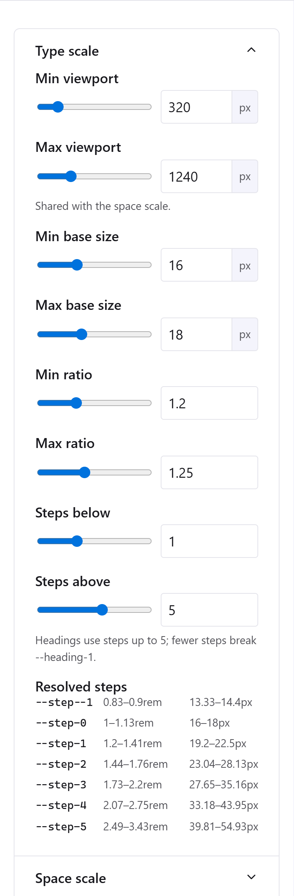
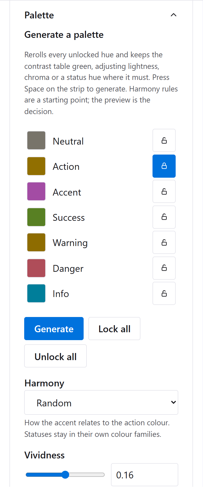
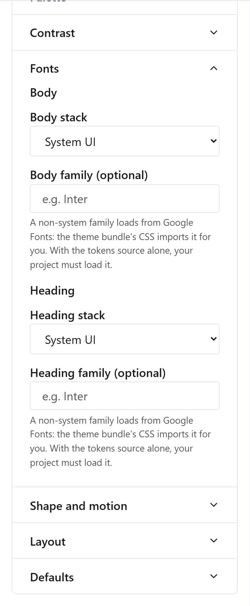
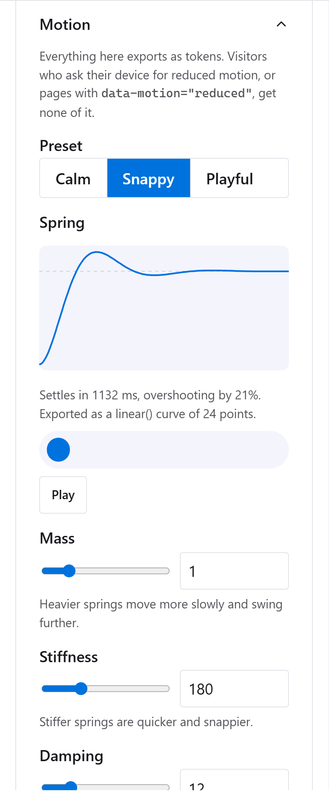
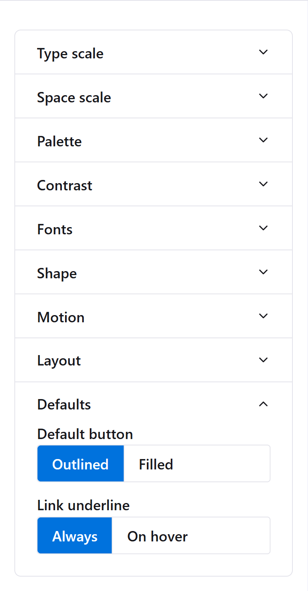
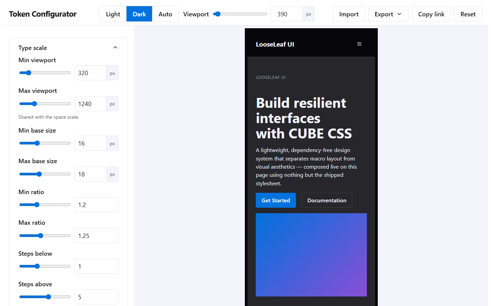
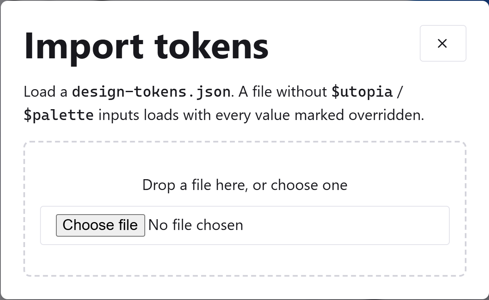

# Token configurator walkthrough

The token configurator is where a LooseLeaf theme is made. You adjust the design tokens (type scale, spacing, colours, fonts, shapes and defaults) while a live preview of every block updates, then export the result for your project.

**[Open the configurator](https://stockol.github.io/looseleaf-ui/)**. Nothing is installed and nothing is uploaded: it runs entirely in your browser. To work offline, open `tools/configure.html` from a copy of this repository by double-clicking it; no server is needed.

## The screen at a glance

- **Toolbar** (top): the colour scheme of the preview (Light, Dark, Auto), the preview's viewport width, and **Import**, **Export**, **Copy link** and **Reset**.
- **Controls** (left): nine sections, one open at a time. Every value has a slider and a number field; type in the field for an exact value.
- **Preview** (right): the real LooseLeaf demo page, with every composition and block, rendered with your draft tokens. What you see here is exactly what your project will get.

The tool's own interface always uses the default LooseLeaf look and follows your system's light or dark setting, so a draft with unreadable colours can never make the tool itself unusable.

## 1. Type scale

LooseLeaf's type is fluid: each size grows smoothly between a small screen and a large one, using the [Utopia](https://utopia.fyi/) method.

- **Min viewport / Max viewport**: the screen widths where sizes stop shrinking and stop growing. These are shared with the space scale.
- **Min base size / Max base size**: body text size at those two widths.
- **Min ratio / Max ratio**: how much bigger each step is than the one below. A larger max ratio gives more dramatic headings on big screens.
- **Steps below / Steps above**: how many sizes are generated either side of the body size.

**Resolved steps** lists every generated size (`--step--1` to `--step-5`) with its smallest and largest value. Headings use steps up to 5 (`--heading-1` is step 5), so keep **Steps above** at 5 or more; with fewer, the draft stops compiling and the preview pauses with a message saying why.

## 2. Space scale

Spacing is fluid too, and uses the same viewports. Set the base space (usually equal to the base font size) and the multipliers for each named size from `3xs` to `3xl`. The one-up pairs used for generous gaps (`s-m`, `m-l`, `l-xl`) are generated for you. The resolved list underneath shows each value's range.

## 3. Palette

### Generating a palette

The top of the Palette panel can make a whole palette for you, quickly. It picks a hue for each role (neutral, action, accent and the four statuses) rather than five arbitrary colours, and the lightness of every text, surface and border is already fixed by the palette's recipes, so what it produces is coherent from the start. Its job is to make it good, and to keep the contrast table green.

- **Generate** rerolls every slot that isn't locked. With the slot list focused, **Space** does the same.
- **Padlocks** keep a slot as it is. **Lock all** and **Unlock all** do every slot at once.
- **Harmony** sets how the accent relates to the action colour: analogous, complementary, split-complementary, triadic, or random (which picks one of those).
- **Vividness** is one colourfulness for action and accent, with the statuses at 0.8 of it and the neutral barely tinted. Matching saturation is most of what makes a palette look designed.
- Status colours always stay in their families: danger red-ish, warning amber, success green-ish, info blue-ish, at the point nearest the harmony. Otherwise alerts would be misread.

After every palette, the generator checks every pair in the contrast table in both schemes, and fixes any that fall short of WCAG AA. It changes the lightness behind the colour first, then lowers its chroma, then nudges a status hue towards the edge of its band. A change is kept only if it doesn't break another pair. Each one is listed under **Adjusted to meet AA** with an undo button. Anything it still can't fix is listed as **Best available**, with its ratio. A locked slot never changes hue, though its lightness or chroma may, and the list says so.

Links and buttons share the action colour, and pull it in opposite directions: white text on a button wants it dark, a link on the dark page wants it light. When that bites, the generator moves dark-scheme links to the lighter action step (`--action-400`), so both pass.

**Start from a colour** takes a hex code, a brand colour, say. It becomes the locked action colour, and everything else follows from it. If white text can't sit on it at AA, what happens depends on how far the colour would have to move:

- **A small shift** (up to 0.15 in lightness, which covers most blues and reds) is invisible, and white text is the convention, so the colour moves. The panel says by how much, and **Use exact hex anyway** keeps it exact with dark text instead.
- **A big shift** (yellows, light cyans and limes) would stop it being your colour, so the hex stays exactly as you pasted it and the text on buttons switches to dark. **Move the colour to keep white text** does the opposite.

Either way the panel reports what it did and why, and the choice holds as you keep generating.

**History** keeps the last ten palettes; click one to bring it back. The generator's settings, locks and history are saved with your draft and travel in a **Copy link**, but they stay out of every export: the theme gets only the palette itself.

Harmony rules are heuristics. The generator is for exploring quickly; looking at the preview is still the decision. It doesn't pull colours from photos; that's a different tool.

### Hues and chroma by hand

Colours are chosen as a **hue** (0 to 360 degrees around the colour wheel) and a **chroma** (how colourful), in the perceptual OKLCH colour space. The tool generates each ramp from those two numbers, so the steps stay evenly spaced in lightness and every colour is checked to fit within what screens can show.

- **Neutral**: the greys used for text, surfaces and borders. Keep the chroma low (0 to 0.03); a little chroma tints the greys warm or cool.
- **Action**: buttons, links and focus rings.
- **Accent**: decoration such as the gradient and the background mesh.
- **Status**: one hue each for success, warning, danger and info. The light and dark surface, border and text colours are derived from it.

Every generated colour appears as a swatch with its hex value. To use an exact colour instead, click the small colour box under a swatch and pick one: the swatch is marked **overridden**, and an undo button beside it returns it to the generated value.

## 4. Contrast

The contrast table checks every important pairing (body text, muted text, status messages, links and button text against their backgrounds) in **both** schemes, using the WCAG 2 contrast ratio:

- **Green** is 4.5:1 or more and meets WCAG AA for normal text.
- **Amber** is between 3:1 and 4.5:1, enough only for large text.
- **Red** is below 3:1.

Aim for green in both columns. The table updates as you move the palette sliders, so the quickest fix for an amber cell is to adjust the hue, chroma or swatch it uses while watching that row.

## 5. Fonts

Choose a **stack** for body text and for headings. The stacks come from [Modern Font Stacks](https://modernfontstacks.com/) and use fonts already installed on people's devices, so they cost nothing to load.

To use a web font, type its name (for example `Inter`) in the optional family field. It must be a [Google Fonts](https://fonts.google.com/) family. The preview loads it straight away, and the exported theme CSS imports it, falling back to the stack you chose.

## 6. Shape

- **Radius**: corner rounding for controls (buttons, inputs) and surfaces (cards, dialogs). Badges are always fully rounded.
- **Shadows**: every shadow is several layers, tinted with the neutral hue so it darkens the page's own colour rather than greying it, all lit from one direction. **Shadow strength** sets how dark they are, **Shadow softness** how blurred, and **Light from** where the light comes from. They apply at three elevations: raised (cards, a focused input), floating (menus, toasts, a lifted card) and overlay (dialogs).

## 7. Motion

- **Preset**: **Calm**, **Snappy** or **Playful** sets the spring and the three durations together. Changing any of them afterwards makes the preset custom.
- **Spring**: movement in LooseLeaf (menus dropping in, cards lifting, the accordion's chevron) follows a spring. Three sliders shape it:
  - **Mass**: heavier springs move more slowly and swing further.
  - **Stiffness**: stiffer springs are quicker and snappier.
  - **Damping**: less damping means more bounce. A spring too loose to settle is raised just enough that it does, and the panel says so.

  The plot shows the spring's path from start to rest, with the dashed line marking where it ends up, and the line under it says how long it takes to settle and how far it overshoots. The swatch below bounces along the same curve each time the spring changes, or when you press **Play**. If your system asks for reduced motion, it only moves when you press **Play**. The spring exports as `--ease-spring`, a CSS `linear()` curve.
- **Durations**: the quick, base and slow speeds, in milliseconds. **Standard easing** is the curve for colour and opacity changes.
- **Press scale**: how far buttons and choices shrink while pressed. 1 turns it off.
- **Lift distance**: how far `.anim-lift` and interactive cards rise on hover.
- **Enhancements**: switch **Scroll reveal**, **Page transitions** and **Compact sticky navbar** on or off for the whole site. Page transitions start off: in Chromium, a form that submits back to its own page can leave the page stuck mid-transition, so turn them on only if your site doesn't do that (or you've tested it). A theme with them on carries the rule in its own CSS.

Try the result in the preview's **Motion** section, which has a playground (a button to press, a menu, a dialog, cards to hover) and says which effects the current browser supports.

Visitors who ask their device for reduced motion get none of this: every duration in LooseLeaf drops to zero for them. A site can offer the same choice with `data-motion="reduced"` on `<html>`.

The configurator only ever exports tokens, never scripts. A script copied into your project would miss every fix in later LooseLeaf releases, which is exactly the drift the theme mechanism exists to prevent: your theme sets the values, and the library's own files supply the behaviour.

## 8. Layout

- **Measure**: the comfortable reading width for running text, in characters (`ch`).
- **Wrapper max**: the widest a page section grows, in `rem`.

## 9. Defaults

- **Default button**: whether a plain `.button` (one without a variant) is **Outlined** or **Filled**.
- **Link underline**: whether links in text are underlined **Always** or only **On hover**.

## Check every width and both schemes

- **Light / Dark / Auto** switches the preview's colour scheme. Auto follows your system. Only the preview changes; the controls stay as they are.
- **Viewport** resizes the preview between 320 and 1600 pixels wide. Because the preview is a real page in a frame, fluid type and spacing respond exactly as they will on a phone or a large monitor. When the chosen width is wider than the space available, the preview is scaled down to fit and the percentage is shown beside the field.

Scroll the preview to check every block: navigation, buttons, the full form with its error state, tables, alerts, cards and the rest.

## Saving your work

- Your draft is **saved automatically** in this browser as you work, so you can close the tab and carry on later.
- **Copy link** copies a web address that contains the whole draft. Send it to someone, or keep it to reopen the draft on another device.
- **Reset** discards the draft and goes back to LooseLeaf's defaults. You're asked to confirm first.

## Export

**Export** offers three formats:

- **Theme bundle (.zip)**: what most projects want. It contains:
  - `looseleaf-tokens.css`, your compiled tokens, which load after `looseleaf.css`;
  - `tokens.resolved.json`, every token's final value, read by `django-looseleaf`;
  - `design-tokens.json`, the source, for importing back here later;
  - a `README.txt` with setup instructions.
- **Tokens source (design-tokens.json)**: just the source. Use it to change this repository's own defaults, or to compile in your own build with the command-line tool.
- **Copy tokens CSS**: the compiled stylesheet, copied to the clipboard for a quick paste.

Nothing can be exported while the draft has an error, so whatever you download is exactly what the preview shows.

**Using the export** is covered in the [README's Theming section](../README.md#theming): Route A for Django, Route B for plain HTML or any other backend, Route C for compiling `design-tokens.json` in a build pipeline.

## Import

To keep editing a theme later, choose **Import** and drop in its `design-tokens.json` (from the bundle, or from your project). Every control picks up the theme's values. Change what you need, then export again and replace the files in your project.

A file the compiler can't read is refused with an explanation, and your current draft is left untouched.
